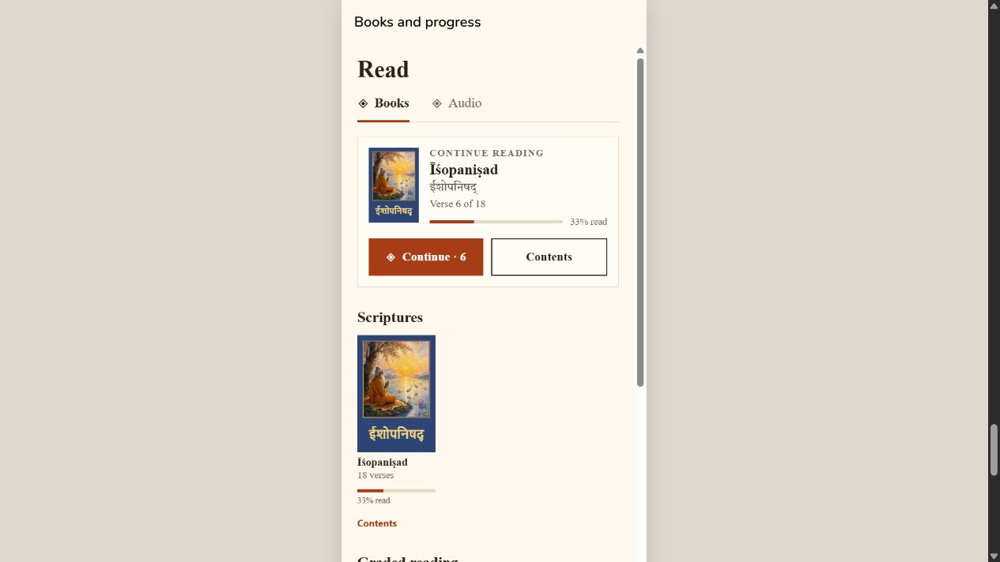
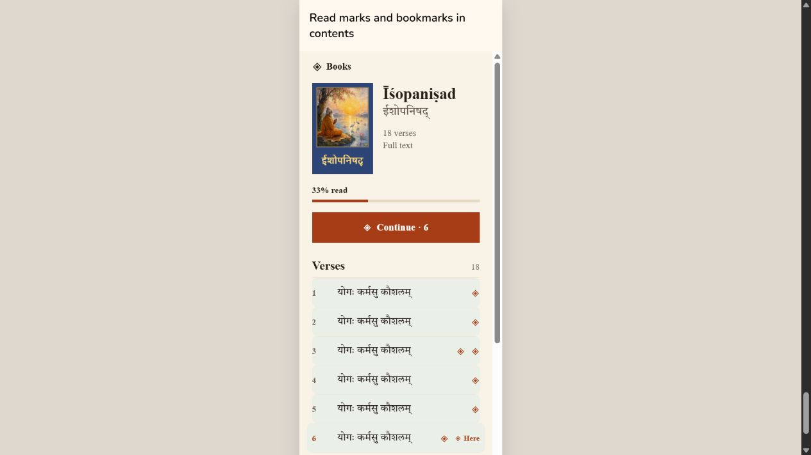
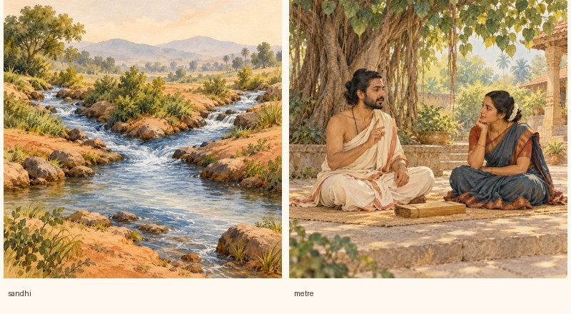

# Pre-release app polish — 19 October 2026

The requested changes are implemented in the working tree. No Google Play release, signed APK/AAB, backend deployment or physical-device validation was performed.

- Startup uses a larger responsive guru portrait, including the native splash configuration.
- Festival descriptions can render before astronomical timings finish, cached dates render during refresh, duplicate requests are consolidated, and yearly calculations are cached and shared between concurrent requests. Non-leap years no longer calculate an unnecessary day from the next year. Request timeout and stale-response protection are included.
- Your daily practice, Word Journey, Do You Know, Progress and Settings have clearer typography, spacing and card treatments.
- The reader keeps its page size when controls appear. The compact toolbar contains Index, Ask anything and Format. The slider stays visible at the bottom. Removed the requested offline/download/mode/word-by-word actions; highlighted Learn & Recite this Shloka yourself.
- Format settings include themes, font sizes, Roman toggle (off for a new preference), background choices and per-section size/color/bold controls. Saved settings and 48% default illustration opacity are preserved.
- Books have a bookmark toggle beside the folio, a Bookmarks tab in the index, read-page highlights/checkmarks, automatic resume and small shelf progress bars. An explicit index selection overrides resume. Cover taps open reading; Contents remains a separate action below each cover. Read counts reflect pages displayed for 1.2 seconds while the reader is focused, rather than assuming all earlier pages were read. Bookmarks and reading history are account scoped. Compact read chunks merge across offline devices; bookmark removal is independent of read history.
- All 57 painted book covers and 23 priority festival images ship with the app. Other large illustrations use R2 with bounded caching and nearby-image prefetch. The actual native exports were checked by content hash: no missing priority images and no other remote paintings bundled. Priority image source bytes total 17,548,696; this is not installed APK size.
- Existing audio streaming/preloading is preserved. Explicit offline audio downloads use AES-256-GCM with per-account device-secure keys. Legacy plaintext downloads migrate to encrypted storage. Private playback files are removed on release/account changes and recovered after crashes. This is app-private offline storage, not a guarantee against a compromised/rooted device; payment/entitlement rules were not changed.
- Added two themed decorative lesson openers (Sandhi confluence and metre/recitation), covering the 36 standalone lessons without an opening illustration. The 62 standalone lessons and 105 full-topic openings now have art. These are shared chapter themes, not 36 unique generated pictures. Full teaching text and tables remain live content. Prompt/source/provenance and verified phone/tablet R2 delivery records are in this folder. Temporary originals were removed after verification.

Validation passed:

- TypeScript (`npx tsc --noEmit`).
- Festival suite: 30 backend tests; cache and learning-state suites: 11 tests; mobile festival checks: 37; recitation checks: 119.
- Card coverage/migration: 105 topics, 1,609 cards and 97 trail lessons. Lesson artwork coverage and variants passed.
- Artwork cache/saved appearance checks, encrypted offline audio and playback checks, crash recovery/first-render checks, learning progress/bookmark/resume/account isolation checks.
- Concurrent 700-page history test retains all pages using 11 compact read entries, plus one separate entry for the second test book. Older offline-device history merges without removing locally read pages.
- Android and iOS native exports completed; see android-export.log, ios-export.log and export-inventory.json. Exports validate bundling, not native runtime behavior or signed installation.
- Production-component HTML fixtures reviewed at 390px and 320px (including large reader text); all nine reviewed layouts have no horizontal overflow. Fixture icons are placeholders and the review does not exercise native modal, touch, secure-key or audio APIs.
- `git diff --check` passed (line-ending warnings only).

Local festival timing evidence: a cold 60-day calendar calculation took 14.7966 seconds; the subsequent cached full-year detail took 0.0114 seconds. This excludes production network/database/cold-start/render time. First-ever astronomical calculation can still take time; descriptions and cached content render independently. Backend deployment is required for the server-side cache and read-history reconciliation improvements.

Before production, install a signed build on a physical Android device and verify launch sizing, real page gestures/sliders, theme controls, bookmarks/resume, encrypted offline audio after restart/sign-out, and the festival first-load behavior against the deployed backend. No Play Console settings were changed.

Visual evidence (production components with test data):

